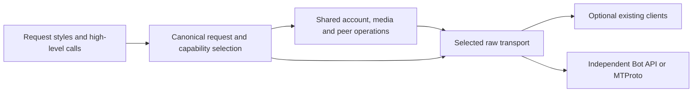

# Unified Telegram client: investigation and implementation

The current implementation provides independent Bot API and encrypted MTProto
RPC paths, optional client adapters, shared account/media operations, and ordered
update recovery. It does **not** yet establish the complete feature union or the
superiority requested in [issue #1](https://github.com/link-foundation/anygram/issues/1).
The [requirement ledger](requirements.md) keeps those acceptance criteria open.
All work is in [PR #2](https://github.com/link-foundation/anygram/pull/2).

## Evidence and research method

`data/issue.json`, `issue-comments.json`, `sub-issues.json`, and the three PR
feedback snapshots preserve the initial requirement sources. The initial snapshot
had no required sub-issues or comments. `experiments/collect-research.mjs` captures
metadata, READMEs, a bounded ranking of ten open issues/PRs by comment count, and
five recently updated closed PRs for nineteen repositories. This is a reproducible
selection rule, not a claim that comment count measures severity or popularity.

`experiments/collect-issues.mjs` saves every comment, with pagination, on the
first three actual issues in each captured competitor ranking. The resulting
29 initial complete discussions are indexed in `data/issues/inventory.json`. A ranking
can contain fewer than three issues because GitHub's repository issues endpoint
also returns PRs. The node-telegram-bot-api ranking contains only a dependency PR;
Pyrogram has disabled issues. Those omissions must not be described as evidence
that the projects have no defects. `collect-followup-research.mjs` adds all
comments on the three highest-comment closed node-telegram-bot-api reports,
bringing the inventory to 32 discussions. It also archives the complete PR,
conversation, inline-comment and review streams for meta-sovereign #34 and #36,
plus the connection-related #17 and #28 PR descriptions.

Embedded screenshots were downloaded with authenticated requests, checked with
`file`, and inspected. `data/issues/images/manifest.json` records 26 retained
images, seven unavailable legacy downloads, and one inspected screenshot omitted
because it exposed a third-party bot token. Subscription authorization links and
bot tokens pasted into report text are redacted by `research-redaction.mjs`.
These are upstream diagnostic images, not screenshots of an Anygram UI fix.

`collect-test-inventory.mjs` records immutable commit hashes and test-related
paths for all nineteen repositories. The matching rule is in the script; fixtures,
helpers and directory contents are included. Counts below are **file inventory**,
not executed test counts, line coverage, or proof of correctness. We have not run
the upstream suites against Anygram, so that part of the requested comparison is
still open.

| Project               | Test-related paths in captured tree | Concrete comparison purpose                                                         |
| --------------------- | ----------------------------------: | ----------------------------------------------------------------------------------- |
| GramJS                |                                   7 | TL classes, string sessions, request bytes, client methods                          |
| teleproto             |                    0 matching paths | Current schema and GramJS-style migration; zero matches does not establish no tests |
| mtcute                |                                 200 | Typed TL, peer/storage abstractions, file-reference management                      |
| @mtproto/core         |                                   2 | String RPCs, authentication/DC behavior                                             |
| grammY                |                                  19 | Middleware, context, Bot API, formatted entities                                    |
| Telegraf              |                                  10 | Middleware, scenes, sessions and webhook lifecycle                                  |
| node-telegram-bot-api |                                  28 | Positional calls, events, polling and legacy migration                              |
| tdl                   |                                  14 | TDLib's distinct request/event model                                                |
| Telethon              |                                  21 | Session interoperability, updates, account methods                                  |
| Pyrogram              |                                   6 | High-level user/bot API; archived source is not a current-maintenance promise       |
| TDLib                 |                                  69 | Persistent state, recovery, native integration and complete client behavior         |
| gotd/td               |                                 375 | Protocol validation, updates and lifecycle regressions                              |
| MadelineProto         |                                 152 | Secret chats, update recovery and long-running resource behavior                    |

The exact revisions are in `data/test-inventory.json`. Executable comparisons pin
GramJS 2.26.22, teleproto 1.232.0, mtcute/core 0.32.7 and tl-runtime 0.32.6. The
schema corpus checks all 869 layer-232 methods and 1,758 non-Bool constructors
against independent serializers where their schemas overlap. Recursive sample
construction is bounded. This verifies serialization, not permission to invoke
every method or correctness of every high-level return model.

## Architecture and reusable components

The canonical pipeline accepts method strings, TL objects, namespace calls, and
GramJS-style requests. Adapters keep original extended methods bound to their
clients. Shared operations use raw invocation rather than reimplementing each
high-level method once per library. Capability selection happens before execution;
a failed request is not silently replayed through another backend. Server-directed
DC migrations are a separate bounded protocol flow.

The issue points to command-stream's competitive approach. Its README and pinned
479-path test inventory support using explicit comparison sets, executable
regressions, and documented compatibility limits here. A blanket claim of beating
all Telegram clients cannot follow from a larger schema or a test-file count.

| Existing component                           | Reuse decision and tradeoff                                                                                                                                                                                                             |
| -------------------------------------------- | --------------------------------------------------------------------------------------------------------------------------------------------------------------------------------------------------------------------------------------- |
| GramJS / teleproto                           | Optional MIT client adapters and actual serializer oracles. Keeping their original client available preserves extensions; it does not prove cross-backend return-model parity.                                                          |
| mtcute core / TL runtime                     | Actual typed request writer used for interoperability checks. The automatic Node client loader stays optional; installing a SQLite binding is unnecessary for native operation.                                                         |
| @mtproto/core                                | Optional backend. Its GPL license prevents calling the combined third-party distribution public domain; its implementation is not copied into Anygram.                                                                                  |
| grammY / Telegraf / node bot API             | Optional Bot API backends; shared native middleware/event facades cover current scenarios. Scene/wizard/session behavior has differential tests; full plugin contracts and positional overloads still need comparison.                  |
| TDLib / tdl                                  | Available as an extended initialized backend. TDLib JSON objects are a different API from MTProto TL; an adapter must translate semantics rather than relabel requests. Native compilation also changes platform/resource requirements. |
| Telegram official schemas and protocol docs  | Pin layer and upstream revision, validate bounds, and implement the native protocol independently. Raw schema coverage does not implement secret-chat key management or voice transport.                                                |
| Web Fetch, Web Crypto and Node primitives    | Reuse request cancellation, multipart encoding, random bytes, hashes and file I/O across runtimes. Node-specific imports currently prevent claiming universal browser/React Native support.                                             |
| grammY parse-mode/i18n and Bot API emulators | Useful candidates for formatted text and differential bot scenarios. Their existence does not solve runtime entity-preserving templates or establish an integrated test suite here.                                                     |

Original implementation code remains under the Unlicense. Optional libraries and
archived upstream research retain their own licenses. The npm allowlist includes
`src`, README and LICENSE, excluding research, competitor packages and credentials;
a final package-content audit is still required.

## Competitor issue findings

Every selected discussion was read through its final captured comment. The
following separates a reproducible mechanism from an unverified upstream diagnosis.
Tests named below are local regression evidence, not a claim that we fixed code in
another repository.

| Reports                                                                                                                                                                 | Finding and resulting implementation / remaining verification                                                                                                                                                                                                                                                                                                                                                                    |
| ----------------------------------------------------------------------------------------------------------------------------------------------------------------------- | -------------------------------------------------------------------------------------------------------------------------------------------------------------------------------------------------------------------------------------------------------------------------------------------------------------------------------------------------------------------------------------------------------------------------------- |
| [GramJS #682](https://github.com/gram-js/gramjs/issues/682), [#654](https://github.com/gram-js/gramjs/issues/654), [#280](https://github.com/gram-js/gramjs/issues/280) | Channel updates stop or arrive inconsistently. Reconnect/getDialogs/getMe workarounds in comments are not proof of root cause. Anygram now tracks independent pts/qts/seq, recovers explicit gaps and persists only after handling; passive channel watching and long-idle recovery still need implementation and live verification.                                                                                             |
| [teleproto #36](https://github.com/sanyok12345/teleproto/issues/36)                                                                                                     | A 10–20-second channel delay motivates explicit channel subscriptions. Telegram's documented short-poll rules, including timeout and a ten-viewed-channel cap, are the implementation target.                                                                                                                                                                                                                                    |
| [teleproto #51](https://github.com/sanyok12345/teleproto/issues/51)                                                                                                     | Outgoing messages disappearing while a session is connected is a correlation. The report does not establish a client deletion bug. Anygram does not automatically delete messages; server/account-policy behavior still requires controlled account evidence.                                                                                                                                                                    |
| [teleproto #42](https://github.com/sanyok12345/teleproto/issues/42)                                                                                                     | Fake-TLS proxy framing, little-endian timestamp and padded-intermediate transport are concrete missing compatibility areas. HTTPS operation is not evidence of MTProxy support. This remains open.                                                                                                                                                                                                                               |
| [mtcute #57](https://github.com/mtcute/mtcute/issues/57), [#54](https://github.com/mtcute/mtcute/issues/54)                                                             | Expo/React Native crypto/storage and Workers request-lifetime/storage constraints require runtime-specific implementations. Workers screenshots/pricing comments changed over time; they cannot establish current hosting costs. Node/Bun/Deno CI does not cover those environments.                                                                                                                                             |
| [mtcute #40](https://github.com/mtcute/mtcute/issues/40)                                                                                                                | Expired media references must be refreshed from their origin. `tests/media.test.js` verifies one bounded refresh and continued chunking; message-origin refresh and advertised document size now have a regression; other origins, CDN and all reference-error variants remain open.                                                                                                                                             |
| [@mtproto/core #279](https://github.com/alik0211/mtproto-core/issues/279)                                                                                               | Removed `messages.getAllChats` is schema drift, not a transport retry condition. The replacement dialog pagination must terminate and preserve offset semantics. Anygram pins a current schema and exposes getDialogs; complete legacy-method migration needs more tests.                                                                                                                                                        |
| [@mtproto/core #177](https://github.com/alik0211/mtproto-core/issues/177)                                                                                               | Authentication must preserve phone-code hash, handle 2FA, migrate DCs and persist authorization. Authentication/session/SRP/DC tests cover these mechanisms; email, paid and passkey flows and account-backed validation remain open.                                                                                                                                                                                            |
| [@mtproto/core #148](https://github.com/alik0211/mtproto-core/issues/148)                                                                                               | Albums require uploaded media to be finalized through `messages.uploadMedia`, reusable input media, and a mandatory message field on each inputSingleMedia. The new album regression failed before implementation and now checks the full call order and captions.                                                                                                                                                               |
| [grammY #110](https://github.com/grammyjs/grammY/issues/110)                                                                                                            | A plugin wishlist mixes many independent features. It is an inventory source, not one reproducible bug. Durable sessions, bulk work and plugin compatibility need individual contracts and tests.                                                                                                                                                                                                                                |
| [grammY #901](https://github.com/grammyjs/grammY/issues/901)                                                                                                            | Bot API emulation can add integration coverage without production credentials. Current injected-Fetch tests exercise native requests; an actual emulator/differential suite remains open.                                                                                                                                                                                                                                        |
| [grammY #669](https://github.com/grammyjs/grammY/issues/669)                                                                                                            | Runtime `{{variables}}` in saved message templates change UTF-16 entity offsets and lengths. Static code-defined formatted strings alone do not solve that use case. Entity-preserving runtime templates now have UTF-16, nesting and actual GramJS serialization regressions; complete parser/plugin behavior remains open.                                                                                                     |
| [Telegraf #1961](https://github.com/telegraf/telegraf/issues/1961)                                                                                                      | ETIMEDOUT reports contain conflicting host/DNS observations. Anygram accepts injected Fetch, redacts tokens and bounds complete response-body reads by a deadline. This does not prove the report's Docker/DNS problem is solved.                                                                                                                                                                                                |
| [Telegraf #1914](https://github.com/telegraf/telegraf/issues/1914)                                                                                                      | Serverless handlers must await database/API work before returning. Sleep-based workarounds do not prove a root cause. Native middleware/webhooks await returned work; background promises that a handler fails to return are not automatically tracked. Session writes and reconstructed wizard steps/state are now awaited and compared with actual Telegraf; external storage durability remains the adapter's responsibility. |
| [Telegraf #894](https://github.com/telegraf/telegraf/issues/894)                                                                                                        | Scene-state typing and per-session isolation are separate requirements. Sharing one module-level object is not a correct workaround. Typed wizard/session examples compile, and independent cloned sessions plus reconstructed scene steps are tested against actual middleware; full plugin compatibility remains open.                                                                                                         |
| [tdl #157](https://github.com/BANNERETS/tdl/issues/157)                                                                                                                 | A no-reject result API must preserve typed errors and request/result correlation. Anygram currently throws typed errors; an explicit result-returning facade is still open.                                                                                                                                                                                                                                                      |
| [tdl #170](https://github.com/BANNERETS/tdl/issues/170)                                                                                                                 | Large channel lookups are bounded by Telegram permissions/rate limits. A library cannot promise arbitrary throughput. Exact IDs, caller-visible flood waits and pagination are supported; account-scale measurements are pending.                                                                                                                                                                                                |
| [tdl #160](https://github.com/BANNERETS/tdl/issues/160)                                                                                                                 | TDLib `updateNewChat` initializes chat metadata and is not proof of a new incoming message. A semantic TDLib event translator is required; raw TL relabeling would be incorrect.                                                                                                                                                                                                                                                 |
| [Telethon #4462](https://github.com/LonamiWebs/Telethon/issues/4462)                                                                                                    | Repeated/old message events motivate transport replay checks, message-box cursor deduplication and bounded handler delivery. Current update regressions verify local mechanisms; full return/event compatibility remains open.                                                                                                                                                                                                   |
| [TDLib #902](https://github.com/tdlib/td/issues/902)                                                                                                                    | The early SQLite-corruption interpretation is revised in later comments toward high concurrent account startup. Deleting persisted data is not justified. Anygram never deletes a session after auth/network failures; bounded multi-account startup and a measured stress case remain open.                                                                                                                                     |
| [TDLib #2696](https://github.com/tdlib/td/issues/2696)                                                                                                                  | Rolling source/API changes require immutable versions and explicit schema updates, not assumptions from old release tags. Runtime comparator versions and the layer-232 source are pinned. Automated update surveillance remains open.                                                                                                                                                                                           |
| [TDLib #1112](https://github.com/tdlib/td/issues/1112)                                                                                                                  | React Native needs an appropriate native wrapper or a fully compatible JavaScript transport/storage stack. Current Node-specific modules do not meet that requirement.                                                                                                                                                                                                                                                           |
| [gotd #1853](https://github.com/gotd/td/issues/1853)                                                                                                                    | A difference can advance pts beyond a buffered live read receipt without including that receipt. A newer cursor is not proof of delivery. A failing regression led to preserving omitted live events, deduplicating exact replays, preserving distinct same-pts events, and handling empty channel differences. Zero-count boundary events have a separate regression.                                                           |
| [gotd #1800](https://github.com/gotd/td/issues/1800)                                                                                                                    | Per-channel timers/goroutines and idle differences scale with membership, but polling also catches missing server pushes. One scheduler now serves at most ten explicitly watched channels, follows the server timeout, and recovers common state after fifteen minutes without pushes. Unit and native-loop integration regressions cover this without per-channel timers; production-scale comparison remains open.            |
| [MadelineProto #1661](https://github.com/danog/MadelineProto/issues/1661)                                                                                               | High-load screenshots lack a controlled workload/profile. Thread rows can share process RSS, so summing them is misleading. No comparative resource-superiority claim is justified; bounded load/profile experiments remain open.                                                                                                                                                                                                |
| [MadelineProto #942](https://github.com/danog/MadelineProto/issues/942)                                                                                                 | This is a thank-you thread, not a bug. It demonstrates why comment-ranked results must be manually classified.                                                                                                                                                                                                                                                                                                                   |
| [MadelineProto #1562](https://github.com/danog/MadelineProto/issues/1562)                                                                                               | Formatting in secret chats requires translating entities into the secret-chat layer and implementing its encryption/state machine. Cloud-chat raw RPC coverage does not solve it. Secret chats remain open.                                                                                                                                                                                                                      |

The historical node-telegram-bot-api reports add three different failure classes:

| Report                                                              | Findings and resulting requirement                                                                                                                                                                                                                                                                                                                                                                                                                                                       |
| ------------------------------------------------------------------- | ---------------------------------------------------------------------------------------------------------------------------------------------------------------------------------------------------------------------------------------------------------------------------------------------------------------------------------------------------------------------------------------------------------------------------------------------------------------------------------------- |
| [#550](https://github.com/yagop/node-telegram-bot-api/issues/550)   | Telegram's HTTP 409 indicates competing getUpdates consumers. Multiple confirmed cases involved dependency injection, duplicate processes or PM2 startup. A second poller must be stopped; endless retry and token replacement do not fix ownership. A regression now verifies one active instance per token/server in the process and ownership release after shutdown. Separate processes require deployment ownership or leases; server conflicts are surfaced without endless retry. |
| [#1136](https://github.com/yagop/node-telegram-bot-api/issues/1136) | EFATAL AggregateError reports include unreachable IPv6 addresses; selecting IPv4 helped several reporters. Later detailed evidence also shows router/geographic filtering even with IPv4. Preserve configurable network behavior rather than universally forcing IPv4 or claiming one root cause. Native transports accept an injected Fetch implementation.                                                                                                                             |
| [#1161](https://github.com/yagop/node-telegram-bot-api/issues/1161) | Telegram does not reliably send service join messages in large groups. Membership tracking needs the explicit chat_member allowed_updates subscription and appropriate bot administration rights. A polling regression verifies the explicit subscription, incoming membership event, and context sender/chat fields. These differ from new_chat_members service messages.                                                                                                               |

The complete discussions contain 37, 36 and 36 comments respectively. Report
selection reflects conversation volume, not a measured incidence rate.

## Downstream requirements

`collect-meta-source.mjs` captures all 333 JavaScript files whose paths contain
`telegram` in meta-sovereign, including source and tests, at one immutable
revision. `meta-telegram-api-inventory.json` indexes literal API constructors,
client operations and invoke sites. Regex extraction misses dynamic constructors;
it is an audit aid and cannot close the downstream acceptance criterion by itself.

| Project                  | Verified building blocks                                                                                                | Remaining application-level evidence                                                                                                                                           |
| ------------------------ | ----------------------------------------------------------------------------------------------------------------------- | ------------------------------------------------------------------------------------------------------------------------------------------------------------------------------ |
| meta-sovereign           | Optional GramJS/teleproto loader, native account login/2FA/sessions, QR token/DC flow, raw layer, history/media/updates | Complete source/test mapping and compatible return models; exports, account/business/stories/gifts, proxies, group/private calls and every source scenario                     |
| konard/telegram-bot      | Account/session import, history pagination, exact IDs, participants, contacts, media and explicit cancellation          | End-to-end Markdown/history export, forwarding/contact extraction, visible-user collection, dry-run contact actions, greeting/sticker and graceful shutdown scenarios          |
| konard/follow            | Join by public username/private invite, leave, dialogs, archive/mute, 2FA                                               | Run its actual scenario suite against native and optional backends, including paging and persisted account state                                                               |
| telegram-terminal-bot    | Shared grammY-style middleware/command/text dispatch, context replies/edits/media, offset after handler, stop           | Full command/restart/help behavior, keyboards, photos/animation and lifecycle scenario matrix                                                                                  |
| telegram-community-posts | onText/on/once, callback_query, positional send/delete/chat calls                                                       | Full posting/deletion/keyboard flow and user-account public search. Its `searchPublicChatMessages` call is not a Telegram Bot API method and must use a user-account transport |

Meta-sovereign's recent merged [greetings PR #36](https://github.com/link-foundation/meta-sovereign/pull/36)
and [automation PR #34](https://github.com/link-foundation/meta-sovereign/pull/34)
reinforce that greetings/stickers and application-triggered drafts/actions are
real downstream needs. A Bot API transport alone cannot replace user-account
operations or application authorization/confirmation logic.

## Protocol references and implementation limits

The independent handshake, envelope and TL details are recorded in [protocol.md](protocol.md).
Additional primary research includes Telegram's [file flow](https://core.telegram.org/api/files),
[update state/recovery rules](https://core.telegram.org/api/updates),
[SRP/password flow](https://core.telegram.org/api/srp), and
[QR login](https://core.telegram.org/api/qr-login). Markdown snapshots are in `data/`.
Two anonymous production handshakes reached a valid encrypted server response;
no live account/API credentials were supplied for authenticated end-to-end tests.
The protocol integration tests use a deterministic encrypted server fixture.

The account factory now loads portable keys into actual GramJS StringSession
objects before constructing the client, preserves the imported address/port, and
persists only successful login changes. Tests exercise the installed library's
constructor and session parser. Shared operations additionally resolve cached
Peer constructors, fetch uncached InputPeer entities, list contacts and empty-chat
greeting stickers, and download profile photos. Media downloads can refresh an
expired reference from its original message and enforce an advertised document
size. These tests establish bounded mechanisms, not full downstream parity.

Important unfinished areas include complete library-style return types/events,
secret-chat DH/rekey/encryption, call media and networking, proxy/transports,
runtime-specific storage/crypto, login challenge variants, non-message file
origins and CDN transfers. These remain part
of this PR's objective and are not silently removed from the acceptance scope.

## CI investigation

The original run [40767145945](https://github.com/link-foundation/anygram/actions/runs/40767145945)
failed because a macOS arm64 job never acquired a runner. Current jobs use
`macos-15-intel`, retaining macOS coverage. Run
[40768406483](https://github.com/link-foundation/anygram/actions/runs/40768406483)
then failed during Windows dependency installation: better-sqlite3 had no usable
prebuilt binary and node-gyp could not recognize the runner's Visual Studio
installation. It came only from the unnecessary @mtcute/node development
dependency. Removing it preserves the core/TL comparison and keeps the optional
Node client available to users who install it themselves.

The same installation failure was preserved from Windows job 123117596852 of
run 40770937418. That stale workflow was cancelled after its completed failed job
was archived. A newer pending workflow had replaced run 40773052722 before it
started. Run [40774789695](https://github.com/link-foundation/anygram/actions/runs/40774789695)
at commit b320b6a completed successfully across all nine runtime/OS combinations,
lint/format and release gates. Later commits require their own CI evidence; the
old green run cannot establish their status.

Run [40778351628](https://github.com/link-foundation/anygram/actions/runs/40778351628)
at commit 54b8bc6 passed the runtime matrix and release checks for the portable
factory change. Local Node/Bun/Deno tests and declaration checks also cover the
watched-channel scheduler; newer changes require their own verification.
The implementation includes regressions that failed before each relevant fix.
Real-account scenarios and the complete acceptance ledger
remain unfinished; this document does not mark the issue complete.

## Formatted text comparison

[Telegram entity documentation](https://core.telegram.org/api/entities) defines
UTF-16 offsets and nesting constraints. The current [grammY parse-mode API](https://grammy.dev/plugins/parse-mode)
accepts text/caption entities and paired format tags. Anygram now preserves
entities through runtime localized templates, tagged templates, incoming captions
and chain methods. Tests cover emoji offsets, immutable fragments, literal
markup, invalid bounds/nesting, Bot API replies/edits/captions and actual GramJS
request serialization. This addresses the concrete runtime interpolation problem
in grammY #669; complete parse-mode plugin and scene compatibility remains open.

At commit d1ebd63 the local Node, Bun and Deno suites each pass 103 tests; lint,
formatting, duplication and all four declaration entry points pass. CI at
0c9cc9a ([40780113550](https://github.com/link-foundation/anygram/actions/runs/40780113550))
passed the runtime matrix and release gates. Subsequent commits need their own
CI evidence. Archived research, upstream screenshots and source snapshots retain
their original authors' rights; they are excluded from the npm payload.

## HTTP and bot session regressions

HTTP fixtures demonstrated six failures before the fix: pre-cancelled requests
reached fetch, malformed/successful-on-HTTP-failure Bot API envelopes were
accepted, JSON/file responses were unbounded, MTProto ignored per-call deadlines,
and response readers remained locked. Both native HTTP transports now share a
bounded reader with abort cancellation and guaranteed lock release. The test
bodies contain at most nine bytes, and deadline probes have explicit watchdogs.
All 108 tests passed on Node/Bun/Deno after this change; CI for 8239dd9 is
[40781650319](https://github.com/link-foundation/anygram/actions/runs/40781650319).

[grammY sessions](https://grammy.dev/plugins/session) and
[Telegraf sessions](https://telegraf.js.org/functions/session.html) use different
keys and failure persistence policies. One independent implementation now accepts
both storage interfaces, awaits writes, clones stored values, and serializes
updates sharing a key. Differential tests execute the pinned real middleware to
compare keys, initialization, writes, deletion and behavior after handler errors.
The default memory store has bounded LRU entries and a timer-free TTL. The
executable bot reconstruction example demonstrates reuse of the storage adapter;
it does not claim durable storage without a persistent adapter. Typed middleware
flavors retain the application's session type. Lazy/multi sessions, complete scene/plugin parity
and distributed coordination remain open. The local suite now passes 113 tests
on Node, Bun and Deno, with clean lint/format/duplication and declaration checks.

The same composer now drives nested middleware, bot registration, commands, text
matching and callback actions. Tests compare the resulting trace with both real
frameworks. A Telegraf facade registers `/start` handlers separately from polling
launch; its context exposes the username through `me` and the user through
`botInfo`. The extra context regression failed before introducing the variant.
The typed bot examples compile with application session flavors. All 116 tests
pass locally on Node/Bun/Deno, and strict lint, formatting, duplication and the
four declaration entry points pass. CI for the preceding session commit 73b71b0
is [40782326161](https://github.com/link-foundation/anygram/actions/runs/40782326161);
run [40782863152](https://github.com/link-foundation/anygram/actions/runs/40782863152)
passed all nine test jobs for the composer commit, but failed formatting.

## Scene comparisons and formatter mismatch

Base scenes, stages and wizards share the composer and session pipeline.
`tests/scenes.test.js` runs actual Telegraf alongside Anygram for entry hooks,
persisted cursor/state after reconstructing the bot, expiry, silent entry,
reentry, leave and continuation. A separate finite regression enforces an
eight-transition test limit; the default production limit is 32 per update.
`examples/typed-wizard.ts` preserves the application's session fields while
compiling the scene and wizard context. Node/Bun/Deno each pass all 120 tests;
strict lint, formatting, duplication and declaration checks pass locally.
These checks establish those scene mechanisms, not the entire plugin ecosystem.

The failed formatting job in run 40782863152 reported `src/index.d.ts` at
archived log line 963 and exited at line 965. Deno's automatic node_modules
setup had replaced the local Prettier executable with 3.9.10, while npm CI used
locked version 3.7.4. Formatting the committed declaration through the latter
reproduced its different union layout. Both lockfiles now select pinned 3.7.4,
and the commit hook checks TypeScript as well as JavaScript and Markdown.
The corrected head still requires its own CI evidence.
