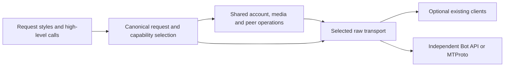

# Unified Telegram client: investigation and implementation

The current implementation provides independent Bot API and encrypted MTProto
RPC paths, optional client adapters, shared account/media operations, and ordered
update recovery. It does **not** yet establish the complete feature union or the
superiority requested in [issue #1](https://github.com/link-foundation/anygram/issues/1).
The [requirement ledger](requirements.md) keeps those acceptance criteria open.
All work is in [PR #2](https://github.com/link-foundation/anygram/pull/2).

Historical checkpoints below reported duplication-check exit status. A later
investigation found the inherited configuration selected the nonexistent source
format `console`, so those checks scanned no files. They did not establish
absence of duplicated code. The duplication checkpoint records the repair and
actual source scan.

## Evidence and research method

`data/issue.json`, `issue-comments.json`, `sub-issues.json`, and the three PR
feedback snapshots preserve the initial requirement sources. The initial snapshot
had no required sub-issues or comments. `experiments/collect-research.mjs` captures
metadata, READMEs, a bounded ranking of ten open issues/PRs by comment count, and
five recently updated closed PRs for nineteen repositories. This is a reproducible
selection rule, not a claim that comment count measures severity or popularity.

`experiments/collect-issues.mjs` saves every comment, with pagination, on the
first three actual issues in each captured competitor ranking. The resulting
29 initial complete discussions are indexed in `data/issues/inventory.json`. A ranking
can contain fewer than three issues because GitHub's repository issues endpoint
also returns PRs. The node-telegram-bot-api ranking contains only a dependency PR;
Pyrogram has disabled issues. Those omissions must not be described as evidence
that the projects have no defects. `collect-followup-research.mjs` adds all
comments on the three highest-comment closed node-telegram-bot-api reports,
bringing the inventory to 32 discussions. It also archives the complete PR,
conversation, inline-comment and review streams for meta-sovereign #34 and #36,
plus the connection-related #17 and #28 PR descriptions.

Embedded screenshots were downloaded with authenticated requests, checked with
`file`, and inspected. `data/issues/images/manifest.json` records 26 retained
images, seven unavailable legacy downloads, and one inspected screenshot omitted
because it exposed a third-party bot token. Subscription authorization links and
bot tokens pasted into report text are redacted by `research-redaction.mjs`.
These are upstream diagnostic images, not screenshots of an Anygram UI fix.

`collect-test-inventory.mjs` records immutable commit hashes and test-related
paths for all nineteen repositories. The matching rule is in the script; fixtures,
helpers and directory contents are included. Counts below are **file inventory**,
not executed test counts, line coverage, or proof of correctness. We have not run
the upstream suites against Anygram, so that part of the requested comparison is
still open.

| Project               | Test-related paths in captured tree | Concrete comparison purpose                                                         |
| --------------------- | ----------------------------------: | ----------------------------------------------------------------------------------- |
| GramJS                |                                   7 | TL classes, string sessions, request bytes, client methods                          |
| teleproto             |                    0 matching paths | Current schema and GramJS-style migration; zero matches does not establish no tests |
| mtcute                |                                 200 | Typed TL, peer/storage abstractions, file-reference management                      |
| @mtproto/core         |                                   2 | String RPCs, authentication/DC behavior                                             |
| grammY                |                                  19 | Middleware, context, Bot API, formatted entities                                    |
| Telegraf              |                                  10 | Middleware, scenes, sessions and webhook lifecycle                                  |
| node-telegram-bot-api |                                  28 | Positional calls, events, polling and legacy migration                              |
| tdl                   |                                  14 | TDLib's distinct request/event model                                                |
| Telethon              |                                  21 | Session interoperability, updates, account methods                                  |
| Pyrogram              |                                   6 | High-level user/bot API; archived source is not a current-maintenance promise       |
| TDLib                 |                                  69 | Persistent state, recovery, native integration and complete client behavior         |
| gotd/td               |                                 375 | Protocol validation, updates and lifecycle regressions                              |
| MadelineProto         |                                 152 | Secret chats, update recovery and long-running resource behavior                    |

The exact revisions are in `data/test-inventory.json`. Executable comparisons pin
GramJS 2.26.22, teleproto 1.232.0, mtcute/core 0.32.7 and tl-runtime 0.32.6. The
schema corpus checks all 869 layer-232 methods and 1,758 non-Bool constructors
against independent serializers where their schemas overlap. Recursive sample
construction is bounded. This verifies serialization, not permission to invoke
every method or correctness of every high-level return model.

## Architecture and reusable components

The canonical pipeline accepts method strings, TL objects, namespace calls, and
GramJS-style requests. Adapters keep original extended methods bound to their
clients. Shared operations use raw invocation rather than reimplementing each
high-level method once per library. Capability selection happens before execution;
a failed request is not silently replayed through another backend. Server-directed
DC migrations are a separate bounded protocol flow.

The issue points to command-stream's competitive approach. Its README and pinned
479-path test inventory support using explicit comparison sets, executable
regressions, and documented compatibility limits here. A blanket claim of beating
all Telegram clients cannot follow from a larger schema or a test-file count.

| Existing component                           | Reuse decision and tradeoff                                                                                                                                                                                                             |
| -------------------------------------------- | --------------------------------------------------------------------------------------------------------------------------------------------------------------------------------------------------------------------------------------- |
| GramJS / teleproto                           | Optional MIT client adapters and actual serializer oracles. Keeping their original client available preserves extensions; it does not prove cross-backend return-model parity.                                                          |
| mtcute core / TL runtime                     | Actual typed request writer used for interoperability checks. The automatic Node client loader stays optional; installing a SQLite binding is unnecessary for native operation.                                                         |
| @mtproto/core                                | Optional backend. Its GPL license prevents calling the combined third-party distribution public domain; its implementation is not copied into Anygram.                                                                                  |
| grammY / Telegraf / node bot API             | Optional Bot API backends; shared native middleware/event facades cover current scenarios. Scene/wizard/session behavior has differential tests; full plugin contracts and positional overloads still need comparison.                  |
| TDLib / tdl                                  | Available as an extended initialized backend. TDLib JSON objects are a different API from MTProto TL; an adapter must translate semantics rather than relabel requests. Native compilation also changes platform/resource requirements. |
| Telegram official schemas and protocol docs  | Pin layer and upstream revision, validate bounds, and implement the native protocol independently. Raw schema coverage does not implement secret-chat key management or voice transport.                                                |
| Web Fetch, Web Crypto and Node primitives    | Reuse request cancellation, multipart encoding, random bytes, hashes and file I/O across runtimes. Node-specific imports currently prevent claiming universal browser/React Native support.                                             |
| grammY parse-mode/i18n and Bot API emulators | Useful candidates for formatted text and differential bot scenarios. Their existence does not solve runtime entity-preserving templates or establish an integrated test suite here.                                                     |

Original implementation code remains under the Unlicense. Optional libraries and
archived upstream research retain their own licenses. The npm allowlist includes
`src`, README and LICENSE, excluding research, competitor packages and credentials;
a final package-content audit is still required.

## Competitor issue findings

Every selected discussion was read through its final captured comment. The
following separates a reproducible mechanism from an unverified upstream diagnosis.
Tests named below are local regression evidence, not a claim that we fixed code in
another repository.

| Reports                                                                                                                                                                 | Finding and resulting implementation / remaining verification                                                                                                                                                                                                                                                                                                                                                                    |
| ----------------------------------------------------------------------------------------------------------------------------------------------------------------------- | -------------------------------------------------------------------------------------------------------------------------------------------------------------------------------------------------------------------------------------------------------------------------------------------------------------------------------------------------------------------------------------------------------------------------------- |
| [GramJS #682](https://github.com/gram-js/gramjs/issues/682), [#654](https://github.com/gram-js/gramjs/issues/654), [#280](https://github.com/gram-js/gramjs/issues/280) | Channel updates stop or arrive inconsistently. Reconnect/getDialogs/getMe workarounds in comments are not proof of root cause. Anygram now tracks independent pts/qts/seq, recovers explicit gaps and persists only after handling; passive channel watching and long-idle recovery still need implementation and live verification.                                                                                             |
| [teleproto #36](https://github.com/sanyok12345/teleproto/issues/36)                                                                                                     | A 10–20-second channel delay motivates explicit channel subscriptions. Telegram's documented short-poll rules, including timeout and a ten-viewed-channel cap, are the implementation target.                                                                                                                                                                                                                                    |
| [teleproto #51](https://github.com/sanyok12345/teleproto/issues/51)                                                                                                     | Outgoing messages disappearing while a session is connected is a correlation. The report does not establish a client deletion bug. Anygram does not automatically delete messages; server/account-policy behavior still requires controlled account evidence.                                                                                                                                                                    |
| [teleproto #42](https://github.com/sanyok12345/teleproto/issues/42)                                                                                                     | Fake-TLS proxy framing, little-endian timestamp and padded-intermediate transport are concrete missing compatibility areas. HTTPS operation is not evidence of MTProxy support. This remains open.                                                                                                                                                                                                                               |
| [mtcute #57](https://github.com/mtcute/mtcute/issues/57), [#54](https://github.com/mtcute/mtcute/issues/54)                                                             | Expo/React Native crypto/storage and Workers request-lifetime/storage constraints require runtime-specific implementations. Workers screenshots/pricing comments changed over time; they cannot establish current hosting costs. Node/Bun/Deno CI does not cover those environments.                                                                                                                                             |
| [mtcute #40](https://github.com/mtcute/mtcute/issues/40)                                                                                                                | Expired media references must be refreshed from their origin. `tests/media.test.js` verifies one bounded refresh and continued chunking; message-origin refresh and advertised document size now have a regression; other origins, CDN and all reference-error variants remain open.                                                                                                                                             |
| [@mtproto/core #279](https://github.com/alik0211/mtproto-core/issues/279)                                                                                               | Removed `messages.getAllChats` is schema drift, not a transport retry condition. The replacement dialog pagination must terminate and preserve offset semantics. Anygram pins a current schema and exposes getDialogs; complete legacy-method migration needs more tests.                                                                                                                                                        |
| [@mtproto/core #177](https://github.com/alik0211/mtproto-core/issues/177)                                                                                               | Authentication must preserve phone-code hash, handle 2FA, migrate DCs and persist authorization. Authentication/session/SRP/DC/email tests cover these mechanisms; paid/passkey flows and account-backed validation remain open.                                                                                                                                                                                                 |
| [@mtproto/core #148](https://github.com/alik0211/mtproto-core/issues/148)                                                                                               | Albums require uploaded media to be finalized through `messages.uploadMedia`, reusable input media, and a mandatory message field on each inputSingleMedia. The new album regression failed before implementation and now checks the full call order and captions.                                                                                                                                                               |
| [grammY #110](https://github.com/grammyjs/grammY/issues/110)                                                                                                            | A plugin wishlist mixes many independent features. It is an inventory source, not one reproducible bug. Durable sessions, bulk work and plugin compatibility need individual contracts and tests.                                                                                                                                                                                                                                |
| [grammY #901](https://github.com/grammyjs/grammY/issues/901)                                                                                                            | Bot API emulation can add integration coverage without production credentials. Current injected-Fetch tests exercise native requests; an actual emulator/differential suite remains open.                                                                                                                                                                                                                                        |
| [grammY #669](https://github.com/grammyjs/grammY/issues/669)                                                                                                            | Runtime `{{variables}}` in saved message templates change UTF-16 entity offsets and lengths. Static code-defined formatted strings alone do not solve that use case. Entity-preserving runtime templates now have UTF-16, nesting and actual GramJS serialization regressions; complete parser/plugin behavior remains open.                                                                                                     |
| [Telegraf #1961](https://github.com/telegraf/telegraf/issues/1961)                                                                                                      | ETIMEDOUT reports contain conflicting host/DNS observations. Anygram accepts injected Fetch, redacts tokens and bounds complete response-body reads by a deadline. This does not prove the report's Docker/DNS problem is solved.                                                                                                                                                                                                |
| [Telegraf #1914](https://github.com/telegraf/telegraf/issues/1914)                                                                                                      | Serverless handlers must await database/API work before returning. Sleep-based workarounds do not prove a root cause. Native middleware/webhooks await returned work; background promises that a handler fails to return are not automatically tracked. Session writes and reconstructed wizard steps/state are now awaited and compared with actual Telegraf; external storage durability remains the adapter's responsibility. |
| [Telegraf #894](https://github.com/telegraf/telegraf/issues/894)                                                                                                        | Scene-state typing and per-session isolation are separate requirements. Sharing one module-level object is not a correct workaround. Typed wizard/session examples compile, and independent cloned sessions plus reconstructed scene steps are tested against actual middleware; full plugin compatibility remains open.                                                                                                         |
| [tdl #157](https://github.com/BANNERETS/tdl/issues/157)                                                                                                                 | A no-reject result API must preserve typed errors and request/result correlation. Anygram currently throws typed errors; an explicit result-returning facade is still open.                                                                                                                                                                                                                                                      |
| [tdl #170](https://github.com/BANNERETS/tdl/issues/170)                                                                                                                 | Large channel lookups are bounded by Telegram permissions/rate limits. A library cannot promise arbitrary throughput. Exact IDs, caller-visible flood waits and pagination are supported; account-scale measurements are pending.                                                                                                                                                                                                |
| [tdl #160](https://github.com/BANNERETS/tdl/issues/160)                                                                                                                 | TDLib `updateNewChat` initializes chat metadata and is not proof of a new incoming message. A semantic TDLib event translator is required; raw TL relabeling would be incorrect.                                                                                                                                                                                                                                                 |
| [Telethon #4462](https://github.com/LonamiWebs/Telethon/issues/4462)                                                                                                    | Repeated/old message events motivate transport replay checks, message-box cursor deduplication and bounded handler delivery. Current update regressions verify local mechanisms; full return/event compatibility remains open.                                                                                                                                                                                                   |
| [TDLib #902](https://github.com/tdlib/td/issues/902)                                                                                                                    | The early SQLite-corruption interpretation is revised in later comments toward high concurrent account startup. Deleting persisted data is not justified. Anygram never deletes a session after auth/network failures; bounded multi-account startup and a measured stress case remain open.                                                                                                                                     |
| [TDLib #2696](https://github.com/tdlib/td/issues/2696)                                                                                                                  | Rolling source/API changes require immutable versions and explicit schema updates, not assumptions from old release tags. Runtime comparator versions and the layer-232 source are pinned. Automated update surveillance remains open.                                                                                                                                                                                           |
| [TDLib #1112](https://github.com/tdlib/td/issues/1112)                                                                                                                  | React Native needs an appropriate native wrapper or a fully compatible JavaScript transport/storage stack. Current Node-specific modules do not meet that requirement.                                                                                                                                                                                                                                                           |
| [gotd #1853](https://github.com/gotd/td/issues/1853)                                                                                                                    | A difference can advance pts beyond a buffered live read receipt without including that receipt. A newer cursor is not proof of delivery. A failing regression led to preserving omitted live events, deduplicating exact replays, preserving distinct same-pts events, and handling empty channel differences. Zero-count boundary events have a separate regression.                                                           |
| [gotd #1800](https://github.com/gotd/td/issues/1800)                                                                                                                    | Per-channel timers/goroutines and idle differences scale with membership, but polling also catches missing server pushes. One scheduler now serves at most ten explicitly watched channels, follows the server timeout, and recovers common state after fifteen minutes without pushes. Unit and native-loop integration regressions cover this without per-channel timers; production-scale comparison remains open.            |
| [MadelineProto #1661](https://github.com/danog/MadelineProto/issues/1661)                                                                                               | High-load screenshots lack a controlled workload/profile. Thread rows can share process RSS, so summing them is misleading. No comparative resource-superiority claim is justified; bounded load/profile experiments remain open.                                                                                                                                                                                                |
| [MadelineProto #942](https://github.com/danog/MadelineProto/issues/942)                                                                                                 | This is a thank-you thread, not a bug. It demonstrates why comment-ranked results must be manually classified.                                                                                                                                                                                                                                                                                                                   |
| [MadelineProto #1562](https://github.com/danog/MadelineProto/issues/1562)                                                                                               | Formatting in secret chats requires translating entities into the secret-chat layer and implementing its encryption/state machine. Cloud-chat raw RPC coverage does not solve it. Secret chats remain open.                                                                                                                                                                                                                      |

The historical node-telegram-bot-api reports add three different failure classes:

| Report                                                              | Findings and resulting requirement                                                                                                                                                                                                                                                                                                                                                                                                                                                       |
| ------------------------------------------------------------------- | ---------------------------------------------------------------------------------------------------------------------------------------------------------------------------------------------------------------------------------------------------------------------------------------------------------------------------------------------------------------------------------------------------------------------------------------------------------------------------------------- |
| [#550](https://github.com/yagop/node-telegram-bot-api/issues/550)   | Telegram's HTTP 409 indicates competing getUpdates consumers. Multiple confirmed cases involved dependency injection, duplicate processes or PM2 startup. A second poller must be stopped; endless retry and token replacement do not fix ownership. A regression now verifies one active instance per token/server in the process and ownership release after shutdown. Separate processes require deployment ownership or leases; server conflicts are surfaced without endless retry. |
| [#1136](https://github.com/yagop/node-telegram-bot-api/issues/1136) | EFATAL AggregateError reports include unreachable IPv6 addresses; selecting IPv4 helped several reporters. Later detailed evidence also shows router/geographic filtering even with IPv4. Preserve configurable network behavior rather than universally forcing IPv4 or claiming one root cause. Native transports accept an injected Fetch implementation.                                                                                                                             |
| [#1161](https://github.com/yagop/node-telegram-bot-api/issues/1161) | Telegram does not reliably send service join messages in large groups. Membership tracking needs the explicit chat_member allowed_updates subscription and appropriate bot administration rights. A polling regression verifies the explicit subscription, incoming membership event, and context sender/chat fields. These differ from new_chat_members service messages.                                                                                                               |

The complete discussions contain 37, 36 and 36 comments respectively. Report
selection reflects conversation volume, not a measured incidence rate.

## Downstream requirements

`collect-meta-source.mjs` captures all 333 JavaScript files whose paths contain
`telegram` in meta-sovereign, including source and tests, at one immutable
revision. `meta-telegram-api-inventory.json` indexes literal API constructors,
client operations and invoke sites. Regex extraction misses dynamic constructors;
it is an audit aid and cannot close the downstream acceptance criterion by itself.

| Project                  | Verified building blocks                                                                                                | Remaining application-level evidence                                                                                                                                           |
| ------------------------ | ----------------------------------------------------------------------------------------------------------------------- | ------------------------------------------------------------------------------------------------------------------------------------------------------------------------------ |
| meta-sovereign           | Optional GramJS/teleproto loader, native account login/2FA/sessions, QR token/DC flow, raw layer, history/media/updates | Complete source/test mapping and compatible return models; exports, account/business/stories/gifts, proxies, group/private calls and every source scenario                     |
| konard/telegram-bot      | Account/session import, history pagination, exact IDs, participants, contacts, media and explicit cancellation          | End-to-end Markdown/history export, forwarding/contact extraction, visible-user collection, dry-run contact actions, greeting/sticker and graceful shutdown scenarios          |
| konard/follow            | Join by public username/private invite, leave, dialogs, archive/mute, 2FA                                               | Run its actual scenario suite against native and optional backends, including paging and persisted account state                                                               |
| telegram-terminal-bot    | Shared grammY-style middleware/command/text dispatch, context replies/edits/media, offset after handler, stop           | Full command/restart/help behavior, keyboards, photos/animation and lifecycle scenario matrix                                                                                  |
| telegram-community-posts | onText/on/once, callback_query, positional send/delete/chat calls                                                       | Full posting/deletion/keyboard flow and user-account public search. Its `searchPublicChatMessages` call is not a Telegram Bot API method and must use a user-account transport |

Meta-sovereign's recent merged [greetings PR #36](https://github.com/link-foundation/meta-sovereign/pull/36)
and [automation PR #34](https://github.com/link-foundation/meta-sovereign/pull/34)
reinforce that greetings/stickers and application-triggered drafts/actions are
real downstream needs. A Bot API transport alone cannot replace user-account
operations or application authorization/confirmation logic.

## Protocol references and implementation limits

The independent handshake, envelope and TL details are recorded in [protocol.md](protocol.md).
Additional primary research includes Telegram's [file flow](https://core.telegram.org/api/files),
[update state/recovery rules](https://core.telegram.org/api/updates),
[SRP/password flow](https://core.telegram.org/api/srp), and
[QR login](https://core.telegram.org/api/qr-login). Markdown snapshots are in `data/`.
Two anonymous production handshakes reached a valid encrypted server response;
no live account/API credentials were supplied for authenticated end-to-end tests.
The protocol integration tests use a deterministic encrypted server fixture.

The account factory now loads portable keys into actual GramJS StringSession
objects before constructing the client, preserves the imported address/port, and
persists only successful login changes. Tests exercise the installed library's
constructor and session parser. Shared operations additionally resolve cached
Peer constructors, fetch uncached InputPeer entities, list contacts and empty-chat
greeting stickers, and download profile photos. Media downloads can refresh an
expired reference from its original message and enforce an advertised document
size. These tests establish bounded mechanisms, not full downstream parity.

Important unfinished areas include complete library-style return types/events,
secret-chat DH/rekey/encryption, call media and networking, proxy/transports,
runtime-specific storage/crypto, login challenge variants, non-message file
origins and CDN transfers. These remain part
of this PR's objective and are not silently removed from the acceptance scope.

## CI investigation

The original run [40767145945](https://github.com/link-foundation/anygram/actions/runs/40767145945)
failed because a macOS arm64 job never acquired a runner. Current jobs use
`macos-15-intel`, retaining macOS coverage. Run
[40768406483](https://github.com/link-foundation/anygram/actions/runs/40768406483)
then failed during Windows dependency installation: better-sqlite3 had no usable
prebuilt binary and node-gyp could not recognize the runner's Visual Studio
installation. It came only from the unnecessary @mtcute/node development
dependency. Removing it preserves the core/TL comparison and keeps the optional
Node client available to users who install it themselves.

The same installation failure was preserved from Windows job 123117596852 of
run 40770937418. That stale workflow was cancelled after its completed failed job
was archived. A newer pending workflow had replaced run 40773052722 before it
started. Run [40774789695](https://github.com/link-foundation/anygram/actions/runs/40774789695)
at commit b320b6a completed successfully across all nine runtime/OS combinations,
lint/format and release gates. Later commits require their own CI evidence; the
old green run cannot establish their status.

Run [40778351628](https://github.com/link-foundation/anygram/actions/runs/40778351628)
at commit 54b8bc6 passed the runtime matrix and release checks for the portable
factory change. Local Node/Bun/Deno tests and declaration checks also cover the
watched-channel scheduler; newer changes require their own verification.
The implementation includes regressions that failed before each relevant fix.
Real-account scenarios and the complete acceptance ledger
remain unfinished; this document does not mark the issue complete.

## Formatted text comparison

[Telegram entity documentation](https://core.telegram.org/api/entities) defines
UTF-16 offsets and nesting constraints. The current [grammY parse-mode API](https://grammy.dev/plugins/parse-mode)
accepts text/caption entities and paired format tags. Anygram now preserves
entities through runtime localized templates, tagged templates, incoming captions
and chain methods. Tests cover emoji offsets, immutable fragments, literal
markup, invalid bounds/nesting, Bot API replies/edits/captions and actual GramJS
request serialization. This addresses the concrete runtime interpolation problem
in grammY #669; complete parse-mode plugin and scene compatibility remains open.

At commit d1ebd63 the local Node, Bun and Deno suites each pass 103 tests; lint,
formatting, duplication and all four declaration entry points pass. CI at
0c9cc9a ([40780113550](https://github.com/link-foundation/anygram/actions/runs/40780113550))
passed the runtime matrix and release gates. Subsequent commits need their own
CI evidence. Archived research, upstream screenshots and source snapshots retain
their original authors' rights; they are excluded from the npm payload.

## HTTP and bot session regressions

HTTP fixtures demonstrated six failures before the fix: pre-cancelled requests
reached fetch, malformed/successful-on-HTTP-failure Bot API envelopes were
accepted, JSON/file responses were unbounded, MTProto ignored per-call deadlines,
and response readers remained locked. Both native HTTP transports now share a
bounded reader with abort cancellation and guaranteed lock release. The test
bodies contain at most nine bytes, and deadline probes have explicit watchdogs.
All 108 tests passed on Node/Bun/Deno after this change; CI for 8239dd9 is
[40781650319](https://github.com/link-foundation/anygram/actions/runs/40781650319).

[grammY sessions](https://grammy.dev/plugins/session) and
[Telegraf sessions](https://telegraf.js.org/functions/session.html) use different
keys and failure persistence policies. One independent implementation now accepts
both storage interfaces, awaits writes, clones stored values, and serializes
updates sharing a key. Differential tests execute the pinned real middleware to
compare keys, initialization, writes, deletion and behavior after handler errors.
The default memory store has bounded LRU entries and a timer-free TTL. The
executable bot reconstruction example demonstrates reuse of the storage adapter;
it does not claim durable storage without a persistent adapter. Typed middleware
flavors retain the application's session type. Lazy/multi sessions, complete scene/plugin parity
and distributed coordination remain open. The local suite now passes 113 tests
on Node, Bun and Deno, with clean lint/format/duplication and declaration checks.

The same composer now drives nested middleware, bot registration, commands, text
matching and callback actions. Tests compare the resulting trace with both real
frameworks. A Telegraf facade registers `/start` handlers separately from polling
launch; its context exposes the username through `me` and the user through
`botInfo`. The extra context regression failed before introducing the variant.
The typed bot examples compile with application session flavors. All 116 tests
pass locally on Node/Bun/Deno, and strict lint, formatting, duplication and the
four declaration entry points pass. CI for the preceding session commit 73b71b0
is [40782326161](https://github.com/link-foundation/anygram/actions/runs/40782326161);
run [40782863152](https://github.com/link-foundation/anygram/actions/runs/40782863152)
passed all nine test jobs for the composer commit, but failed formatting.

## Scene comparisons and formatter mismatch

Base scenes, stages and wizards share the composer and session pipeline.
`tests/scenes.test.js` runs actual Telegraf alongside Anygram for entry hooks,
persisted cursor/state after reconstructing the bot, expiry, silent entry,
reentry, leave and continuation. A separate finite regression enforces an
eight-transition test limit; the default production limit is 32 per update.
`examples/typed-wizard.ts` preserves the application's session fields while
compiling the scene and wizard context. Node/Bun/Deno each pass all 120 tests;
strict lint, formatting, duplication and declaration checks pass locally.
These checks establish those scene mechanisms, not the entire plugin ecosystem.

The failed formatting job in run 40782863152 reported `src/index.d.ts` at
archived log line 963 and exited at line 965. Deno's automatic node_modules
setup had replaced the local Prettier executable with 3.9.10, while npm CI used
locked version 3.7.4. Formatting the committed declaration through the latter
reproduced its different union layout. Both lockfiles now select pinned 3.7.4,
and the commit hook checks TypeScript as well as JavaScript and Markdown.
The corrected scene head passed run 40784060541; native TCP subsequently passed
run 40785578378 across all nine runtime/OS combinations.

## Native TCP checkpoint

The scene/formatter head 35a7b3a passed all nine runtime/OS test jobs and release
checks in [run 40784060541](https://github.com/link-foundation/anygram/actions/runs/40784060541).
The next transport checkpoint passes 133 tests locally on Node, Bun and Deno,
including real local encrypted sockets, four framing modes and actual GramJS
encoder comparisons. A bounded anonymous live full-TCP handshake also succeeded;
[protocol.md](protocol.md#persistent-tcp-verification) records its exact limits.
Typed transport constructors/factories compile without requiring Node type
packages in consumers. The package dry run contains 43 permitted entries and
excludes research, fixtures and optional client dependencies. WebSocket, other proxies,
secret chats, calls and full application/backend parity remain unfinished.

The SOCKS5 checkpoint adds proxy-side DNS, IPv4/IPv6, optional RFC 1929
authentication and bounded negotiation. Before implementation, proxy options
were ignored and the domain fixture failed with ENOTFOUND. Four loopback
regressions now cover fragmented responses, authentication downgrade/failure,
malformed replies, deadlines and preservation of coalesced tunnel bytes.
Node/Bun/Deno each pass 137 tests. See [protocol.md](protocol.md#socks5-connect-verification)
for the precise protocol scope; other proxy protocols remain open.

The obfuscation checkpoint independently implements Telegram's 64-byte
initialization and continuous AES-CTR streams, plus MTProxy secret and signed
test/media DC routing. Actual GramJS headers and successive packets match
byte for byte; loopback peers verify fragmented traffic in both directions.
A live anonymous padded/obfuscated TCP key exchange and encrypted RPC error
decoding succeed. Node/Bun/Deno each pass 142 tests, with strict lint, format,
duplication and TypeScript checks passing. WebSocket, fake TLS, SOCKS4,
secret chats, calls and complete downstream/backend parity remain unfinished.

## WebSocket checkpoint

Native binary WebSocket adds validated HTTP upgrades, client masks, bounded
fragmentation/control frames, numeric Telegram close errors and TLS verification.
The first five regressions failed before implementation. Further failing tests
exposed a TLS-close event race that hid hostname errors and an untyped malformed
UTF-8 close reason; both now preserve explicit failures. Independent `websocket`
1.0.35 server tests verify large masked messages and fragmented replies. Loopback
TLS tests cover trusted/untrusted certificates and hostname mismatch through
SOCKS5. The fixture key is deliberately public and excluded from publication.

The bounded live WebSocket probe completed a production authorization-key exchange
and decrypted CONNECTION_NOT_INITED, without account authorization. Node, Bun and
Deno each pass 150 tests; strict lint, formatting, duplication and declaration/
example checks pass. The npm package contains 47 permitted entries, 829,947 bytes
unpacked, with no test fixtures, research or optional clients bundled. Obfuscation
head 2b3db71 passed all nine runtime/OS jobs and release gates in
[run 40787510801](https://github.com/link-foundation/anygram/actions/runs/40787510801).
The WebSocket head d301af6 subsequently passed all jobs in
[run 40789627439](https://github.com/link-foundation/anygram/actions/runs/40789627439). Browser/Worker runtime support,
fake TLS, SOCKS4, secret chats, calls and complete compatibility/scenarios remain open.

## Shutdown checkpoint

Three failing regressions showed that native disconnect resolved before an
asynchronous transport closed, lost rejected cleanup promises and skipped later
DCs after a synchronous failure. Disconnect now waits for every DC, resets local
initialization before cleanup, preserves a single failure and aggregates multiple
failures. Tests control promise completion directly instead of relying on timing.
All 153 tests pass locally on Node, Bun and Deno. Main was refreshed and remains
an ancestor of this branch at 5b8ebdd.

## Fragmented-read resource checkpoint

The finite `experiments/framing-resources.mjs` probe reproduces quadratic copying
in both receive parsers: a 262,144-byte payload arriving in 128-byte pieces copied
268,828,676 bytes for TCP and 268,828,682 for WebSocket through instrumented
Buffer/TypedArray operations. These are copy counts for this probe, not total
process memory or a production benchmark. Run it with a 128 MiB V8 heap limit;
its payload/chunk validation bounds deliberate stress inputs.

A shared contiguous buffer now grows geometrically, compacts consumed prefixes
and releases allocations over 64 KiB when empty. The same probe records 785,412
and 785,418 copied bytes respectively. Two failing-before/passing-after regressions
enforce an eight-times-payload assembly-copy budget without timing assertions.
A third verifies that compaction, caller input mutation and later buffer reuse
cannot change delivered packets or incomplete data. All 156 tests pass on Node,
Bun and Deno. Shutdown head 15dd3b6 passed all CI jobs in
[run 40789930055](https://github.com/link-foundation/anygram/actions/runs/40789930055).

## SOCKS4 checkpoint

SOCKS4/4a CONNECT shares the existing socket lifecycle and supports IPv4 and
proxy-side domain resolution with bounded UTF-8 user IDs. Four new regressions
cover original-specification bytes, fragmented/coalesced replies, rejection
codes, deadlines and TLS-verified WebSocket traffic through a loopback SOCKS4a
tunnel. A discovered hostname-conversion truncation bug is fixed for SOCKS5 as
well. Unsupported IPv6/password settings fail before connecting.

All 160 tests pass on Node, Bun and Deno; strict lint, formatting, duplication
and TypeScript checks pass. Buffer head ee81109 passed every applicable CI job in
[run 40790365948](https://github.com/link-foundation/anygram/actions/runs/40790365948).
Historical checkpoint counts above describe their respective commits. Fake TLS,
browser/Worker APIs, secret chats, calls and complete backend/application parity
remain open.

## Email authentication checkpoint

The phone-login helper now handles email codes and required email setup using
the specified verification fields and returned code hashes. Google/Apple proofs
require the corresponding server permission flag. Six regressions cover code
and identity proofs, setup transitions, copied callback state, cancellation,
malformed responses and finite challenges; real GramJS serialization verifies
the sign-in wire bytes. A final-step success boundary has a failing-before test.

All 166 tests pass on Node, Bun and Deno, with strict lint, formatting, duplication
and declaration/example checks. SOCKS4 head abb5781 passed all applicable jobs in
[run 40791196241](https://github.com/link-foundation/anygram/actions/runs/40791196241).
Live email delivery, identity-provider tokens and account scenarios remain
unverified; protocol and compatibility requirements stay open.

## Duplication checkpoint

The inherited jscpd configuration used `format: "console"`, selecting a nonexistent
source language. Its successful exit scanned zero files. A new bounded experiment
first reproduces this false success with two identical source files, then verifies
that the corrected configuration rejects clones and scans unique files. The
experiment runs before every duplication check, including CI.

An explicit JavaScript/TypeScript scan initially found eleven production clones.
Shared byte assembly, deadline scopes, socket validation, TL depth checks,
matching middleware, event dispatch and TCP packet handling consolidate them.
The corrected zero-threshold gate scans all 45 production JS/TS files and reports
zero clones at the existing five-line/thirty-token threshold, without suppression
markers. Generated reports are excluded from lint/formatting and remain untracked.

All 166 tests still pass on Node, Bun and Deno. Strict lint, formatting,
duplication and declaration/example checks pass; the package dry run contains
49 permitted files. Email head 2598e6d passed all nine OS/runtime jobs and other
applicable gates in
[run 40791774228](https://github.com/link-foundation/anygram/actions/runs/40791774228).
That run predates the repaired duplication gate; later heads need fresh CI.

The first gate run at e56581a passed all nine runtime/OS jobs, but its duplication
step failed in
[run 40792559002](https://github.com/link-foundation/anygram/actions/runs/40792559002).
The downloaded failed-job log reports `unknown option '--noTips'` at line 270
(line 1039 of the full workflow log). Deno had replaced the local executable
shim with jscpd 4.3.0, which accepts the flag, while npm CI correctly installed
locked 4.0.5, which rejects it. The command now invokes the locked package's
JavaScript entry point directly, omits the unsupported flag, and bounds its heap
at 384 MiB. The detector fixture and production scan both pass with that exact
entry point. Fresh CI is still required for the corrected head.

## Update lifecycle checkpoint

Thirteen new regressions reproduce lifecycle failures before the fix. Stopping
during initialization or watched-channel recovery previously rejected the loop
with its own cancellation; stopping during a poll could restore the old handler
before accepted handlers and cursor persistence finished. A single error slot
also overwrote earlier handler failures, and new-session notifications bypassed
the pending-update bound. Tests use controlled promises and two-second bounds,
with finite 1000-entry overflow probes under a 128 MiB Node heap.

The loop now drains each DC's queues until stable before restoring dispatch,
including updates appended by accepted handlers. Only its own cancellation reason
is discarded; unrelated handler, persistence and polling failures propagate,
with independent failures aggregated. Retained handler failures are bounded to
1000 plus an explicit overflow error, and session notifications share the
1000-entry pending limit. Invalid polling counts fail before storage or RPCs.

All 179 tests pass on Node, Bun and Deno, including thirteen lifecycle cases and
the existing asynchronous DC cleanup tests. Strict lint, formatting, the locked
duplication gate and declaration/example checks pass locally. This verifies the
documented `stopUpdates(); await runPromise` lifecycle, not full client event or
account parity. Fresh CI is required for this head.

The archived primary update documentation also specifies one second for an open
channel when a final difference omits `timeout`. The scheduler incorrectly used
thirty seconds. A fake-clock regression fails before the fallback correction,
checks the 999/1000 millisecond boundary, and verifies polling stops on unwatch.
All 180 tests pass on Node, Bun and Deno, with strict lint, format and duplication
checks. The locked checker repair at e87752c passed all nine OS/runtime jobs and
applicable gates in
[run 40793885312](https://github.com/link-foundation/anygram/actions/runs/40793885312).
This run predates the lifecycle and channel-timeout changes.

## Secret-chat envelope checkpoint

Telegram's [end-to-end specification](https://core.telegram.org/api/end-to-end)
defines a different encrypted envelope from the cloud MTProto header. The
native `SecretChatCipher` implements that MTProto 2.0 byte envelope with explicit
originator direction, a copied 256-byte key, SHA-1 key fingerprint, authenticated
SHA-256 message key, AES-IGE and validated length/padding. Input limits are
checked before large cryptographic allocations. Destroying the cipher clears
its owned key bytes and makes subsequent operations fail.

Six tests failed before the primitive existed. They compare both directions to
independently derived keys and the actual GramJS AES-IGE implementation; crafted
authenticated packets cover minimum/maximum padding, invalid lengths, excess
padding, direction mismatch, corruption, truncation and byte limits. Caller key
mutation and repeated destruction are covered. Cloud and secret envelopes share
their key derivation/authentication primitives rather than duplicating them.

All 186 tests pass on Node, Bun and Deno. Strict lint, format, declaration/example
and duplication checks pass; the detector scans 46 production JS/TS files with
zero clones. The primary schema, encryption, sequence and forward-secrecy
documents are archived with capture timestamps and hashes in
`data/secret-sources.json`. The existing lifecycle and channel-timeout heads
passed all nine runtime/OS jobs in
[run 40794048905](https://github.com/link-foundation/anygram/actions/runs/40794048905)
and [run 40794298276](https://github.com/link-foundation/anygram/actions/runs/40794298276).
Fresh CI is required for this envelope change. This is a byte primitive:
complete secret-chat negotiation, sequencing, persistence, forward secrecy and
live peer verification remain acceptance work.

## Secret-schema checkpoint

The independent end-to-end TL registry contains 90 constructor versions through
layer 216. `SecretChatCodec` defaults to chat layer 144, writes the newest
constructor at the selected layer and accepts all historical IDs through it.
A failing regression showed that the shared codec had discarded older IDs while
building its name map; its read map now retains every definition.

The primary JSON omits four flag-only parameters present in the TL text,
including `silent` and `no_webpage`. The bounded generator therefore reads the
[primary TL text](https://core.telegram.org/schema/end-to-end), supports a local
captured Markdown input and records its source hash. Tests compare all other
fields with the independently archived JSON, round-trip every version, and
check a handwritten wire vector, flags, exact long values, entities, wrappers,
encrypted payloads and size/type/layer rejection. Layer-216 group-call message
constructors serialize separately; this does not implement call-media transport.

All 195 tests pass on Node, Bun and Deno, with strict lint, format, declaration
and duplication checks. The detector scans 47 production JS/TS files with no
clones; the npm dry run has 52 permitted entries. Cipher head 8e1b759 passed every
applicable job in [run 40794806160](https://github.com/link-foundation/anygram/actions/runs/40794806160).
This codec change requires fresh CI. Full secret-chat negotiation, sequence
recovery, persistence, PFS and controlled-account interoperability remain open.

## Windows archive integrity repair

Codec run [40795826588](https://github.com/link-foundation/anygram/actions/runs/40795826588)
was created at 2026-10-29T00:42:41Z for b11141b. Six runtime jobs and all release
checks passed; all three Windows jobs failed the source-hash assertion. The
archived Node log identifies the two hashes at lines 904–905; Bun reports the
same mismatch at 459–460 and Deno at 1268–1269. Each failed job and the full
workflow log are preserved locally in `ci-logs/`.

A finite Git checkout experiment with `core.autocrlf=true` and `core.eol=crlf`
reproduces the exact Windows hash `fbf73e2f…`. Windows Git had changed captured
LF bytes into CRLF, invalidating their recorded provenance. `.gitattributes`
now disables text conversion for archived research data. The assertion still
checks the original bytes and hash. A failing-before/passing-after regression
checks a temporary Windows-style checkout and always removes it. Deno's test
permissions allow only `git` for this new subprocess fixture. All 196 tests and
strict lint, format and duplication checks pass locally on Node, Bun and Deno.
Repair head c996d26 passed all nine runtime/OS jobs and applicable gates in
[run 40796417220](https://github.com/link-foundation/anygram/actions/runs/40796417220),
including all three Windows jobs.

## Secret-chat sequence checkpoint

`SecretChatSequence` implements the role parity, immutable creation-time
headers, ordered acknowledgement validation, duplicate suppression and gap
recovery from Telegram's [sequence specification](https://core.telegram.org/api/end-to-end/seq_no).
Resend services act immediately even behind gaps and run once. Cached frames
retain their exact sequence headers. Unavailable ranges and malformed counters
abort the tracker; pending/history counts and combined byte budgets are bounded.
Frames with fewer than fifteen random bytes are ignored without advancing.

Nineteen regressions include failing-before mechanism, portable-state and restart
cases. They cover both roles, concurrent gaps, reordered acknowledgements,
malicious ranges, bounded queue overflow, history backpressure, independent
returned frames and snapshots, handled services across restart, unsent outbox
recovery and finite counter exhaustion. Snapshots validate canonical encodings,
cache continuity and gap anchors before restoring copied buffers.

All 215 tests pass on Node, Bun and Deno. Strict lint, format, declaration checks
without skipped library checking and the duplication gate pass. The detector
scans 49 production JS/TS files with zero clones; the package dry run contains
54 permitted entries. `examples/typed-secret-chat.ts` demonstrates sending with
a separately negotiated chat and key. Applications must protect plaintext
snapshots and atomically persist returned effects with state before network
operations. This primitive does not yet integrate that transaction with RPCs;
key negotiation, compulsory PFS, deleted-message replacement, encrypted media and
controlled-account interoperability remain acceptance work.

## Decoded byte ownership regression

The TL reader used `.slice()` for byte fields. On a Node `Buffer`, that method
returns a view, so changing one decoded field changed the source packet and
other decoded messages. A failing-before regression covers short/long TL bytes,
int128 and int256, both Buffer and Uint8Array inputs, and nonzero input offsets.
These fields now copy into independent Uint8Arrays. Source reuse and decoded
mutation cannot change each other. All 216 tests pass on Node, Bun and Deno,
with strict lint, format and duplication checks.

Sequence head 236e916 passed all nine runtime/OS jobs and applicable gates in
[run 40797579548](https://github.com/link-foundation/anygram/actions/runs/40797579548).
The byte ownership repair requires its own fresh CI evidence.

## Unacknowledged secret-message deletion

Telegram's [sequence specification](https://core.telegram.org/api/end-to-end/seq_no#deleting-unacknowledged-messages)
requires preserving a deleted outgoing message's position as a self-deletion
service, then sending a second deletion in case the peer already saw the
original. `deleteUnacknowledged` implements both effects, keeps original sequence
headers and clears the replaced owned cache bytes. Resends and restored snapshots
contain the deletion service. Applications still own previously returned frames
and persisted snapshots and must remove those old plaintext copies themselves.

Three initial regressions failed before the method existed. Five passing tests
cover both chat roles, delivery/omission, exact retransmissions, independent
returned frames, restart state, invalid/already-acknowledged targets and capacity
limits. Capacity is checked before evicting or replacing any cache entry; failed
deletions leave snapshots unchanged even when acknowledged history cannot free
enough space. All 221 tests pass on Node, Bun and Deno, alongside strict lint,
format, duplication and full declaration/example checking. The package retains
54 permitted entries. Byte-ownership head 07d27f9 passed all applicable jobs in
[run 40797847810](https://github.com/link-foundation/anygram/actions/runs/40797847810).
Negotiation, PFS, durable RPC integration and live peer verification remain open.

## Secret-chat DH primitive

The initial exchange follows Telegram's [key-generation rules](https://core.telegram.org/api/end-to-end#key-generation):
refresh configuration for every new exchange, validate the 2048-bit safe prime
and generator, mix server entropy with local CSPRNG bytes, bound public values
and left-pad the shared key to 256 bytes. The fingerprint uses the last eight
SHA-1 bytes as a signed little-endian long. A fixed sixteen-entry cache retains
only successful prime proofs; generator and public-value checks still run.

Seven initial regressions failed before the implementation existed. Eight
passing tests now cover both parties, independent platform DH, invalid
parameters/public values, fingerprint mismatches, consumed private exponents,
JSON restart state, server-entropy independence, configuration refresh, copied
inputs and cancellation. Pending snapshots contain the private exponent and
require protected storage. Failed or successful completion clears the owned
exponent. Request/accept RPC integration, layer agreement and compulsory PFS
remain separate unfinished work.

The first full Deno run found a limitation in its independent Node-compatible
DH oracle: it accepts generators 2 and 5, rejecting Telegram's valid generator 3.
The comparison now uses RFC 3526's 2048-bit group with generator 2 on every
runtime, while bilateral tests continue using Telegram's published prime and
generator 3. This retains independent verification without skipping Deno.
All 229 tests pass on Node, Bun and Deno; strict lint, formatting, duplication
and declaration/example checks pass. The detector scans 50 production files
with zero clones, and the package has 55 permitted entries. Declaration-gate
head 192d011 passed all nine runtime/OS jobs and applicable gates in
[run 40798442235](https://github.com/link-foundation/anygram/actions/runs/40798442235).

## Secret-chat layer upgrades

Telegram requires clients to retain their peer's highest known layer and send
a notification when local secret-chat support changes. The sequence primitive
now supports monotonic outgoing-layer upgrades without reserializing older
cached messages. Snapshot validation accepts monotonic historical layers up to
the current layer, preserving exact cached bytes across restart and resends.
Deleting an older unacknowledged message also uses its original layer's codec
for the replacement; only the new follow-up deletion uses the current layer.

Three failing-before regressions exercise 46→73→144 upgrades, exact serialized
cache contents, restart/resend identity, old-layer deletion headers and encoding,
downgrade/unsupported-layer rejection and corrupted history. Layer notification
and envelope-version negotiation still require the integrated client.

All 232 tests pass on each runtime with strict checks; package contents remain
55 permitted entries. DH head 29f274e passed all nine runtime/OS jobs and gates
in [run 40799647031](https://github.com/link-foundation/anygram/actions/runs/40799647031).

## Initial legacy secret envelopes

The current [upgrade rules](https://core.telegram.org/api/end-to-end#upgrading-to-mtproto-2-0-from-mtproto-1-0)
require version 2 after both peers support layer 73, while permitting version-1
messages during initial negotiation and older unresolved gaps. The separately
archived [deprecated format specification](https://core.telegram.org/api/end-to-end_v1)
defines SHA-1-derived keys, x=0 in both directions and zero-to-fifteen padding
bytes excluded from the message-key hash.

`SecretChatCipher` now accepts an explicit version-1 option and keeps version 2
as its default. It performs no automatic fallback between formats. The future
integrated layer policy must track sequence cutovers and reject downgrades.
Three initial regressions failed before the option existed. Six tests now cover
independent GramJS AES verification in both directions, all aligned padding
lengths, a fixed no-padding wire vector, malformed/authentication failures,
strict version separation, bounds, key ownership and destruction.

All 238 tests pass on Node, Bun and Deno with strict checks. The clone detector
scans 51 production files with no clones; the package has 56 permitted entries.
Layer-upgrade head 2d9b3d5 passed every applicable job in
[run 40800006291](https://github.com/link-foundation/anygram/actions/runs/40800006291).

## Layer and envelope transition policy

`SecretChatLayers` starts with peer layer 46 and selects the compatible outgoing
layer/version. It tracks maximal remote support, local notification requirements
and a persisted incoming sequence boundary. Receiving a legacy wrapper carrying
a modern-layer notification does not itself prove the peer has received our
notification: additional legacy messages may already be in flight. A modern
envelope or a wrapper at layer 73 establishes the actual sequence cutover; older
unresolved gaps remain eligible for legacy decryption.

Six failing-before regressions cover the initial notification race, earlier
unresolved gaps, modern cutovers found out of order, invalid queued legacy
messages, immediate wrapper metadata versus ordered service interpretation,
local upgrades, persisted state, strict agreed starting layers and bounded
metadata. A scalar highest-seen legacy sequence detects a queued violation when
an earlier modern boundary is discovered, without retaining a per-message list.
Rejected observations leave policy state unchanged; the integrated client must
abort the chat on protocol errors.

The policy consumes authenticated frames already accepted by sequence checks;
duplicates must be excluded. Queued frames update wrapper/version metadata
immediately, while notify actions wait for ordered delivery. Applications must
persist policy, sequence state and effects together. Request/accept RPCs, durable
client integration, PFS and live peer validation remain unfinished.

All 244 tests pass on Node, Bun and Deno with strict lint, formatting and full
type checking. The clone detector scans 52 production files with no clones;
the package has 57 permitted entries. Legacy-envelope head c465b65 passed
every applicable job in
[run 40800440156](https://github.com/link-foundation/anygram/actions/runs/40800440156).

The policy's CI run
[40801264105](https://github.com/link-foundation/anygram/actions/runs/40801264105)
passed eight runtime/OS jobs and applicable gates, while Node on macOS reported
`TCP request timeout` in a successful socket send in the existing cancellation
test. Failed-job log lines 1028–1045 point to test line 54. Its 30 ms transport
default also constrained connection setup; the intended assertion tests an idle
read. The test now applies that deadline to the read alone, while connection
setup retains the normal test budget. Production behavior is unchanged.

## Initial secret-chat request and acceptance

Telegram's primary
[requestEncryption documentation](https://core.telegram.org/method/messages.requestEncryption)
states that the deduplication random ID also serves as the chat ID. The
[acceptEncryption method](https://core.telegram.org/method/messages.acceptEncryption)
submits the recipient's public value and shared-key fingerprint. The final
[encryptedChat constructor](https://core.telegram.org/constructor/encryptedChat)
carries the other participant's public value for each role.

The new preparation helpers refresh DH configuration, copy participant/input
data before asynchronous work and return a `SecretChatHandshake`. Its mandatory
`save` callback commits pending private state before request/accept RPCs. Request
snapshots retain the same random ID, InputUser and exponent across retries;
acceptance snapshots retain the derived key. Exact signed longs avoid rounding
user IDs and fingerprints. Restore validates canonical encodings, phase/material
consistency, private/public correspondence and stored key fingerprints before
exposing restored state.

Incoming completion checks the chat ID, both participant roles, access hash,
public value and fingerprint. Unrelated IDs preserve the pending exchange.
Invalid exchanges clear owned secret material, save the discarded state and
invoke discardEncryption. Independent protocol, persistence and discard errors
remain visible. Final persistence failures withhold credentials until a save
succeeds; a lost acceptance may need its recovered encryption update if a retry
reports that the server already accepted it.

Five minimal tests initially failed because the APIs did not exist. Ten focused
regressions now cover bilateral DH, exact request/accept replay after JSON
restart, save ordering/failure, concurrent operation rejection, role/public/key
validation, cancellation, copied inputs, malformed snapshots and independent
discard failures. A finite local integration peer exercises both native clients
over encrypted framed TCP, including initialization, real TL method/result
serialization and an unsolicited encryption update. It does not authorize a
Telegram account. Layer/cipher/sequence integration, atomic message effects and
qts cursors, compulsory PFS, encrypted media and controlled live accounts remain
open.

The scoped TCP deadline repair f083ace passed all nine runtime/OS jobs and
applicable gates in
[run 40802116364](https://github.com/link-foundation/anygram/actions/runs/40802116364).

All 254 tests pass on Node, Bun and Deno; strict lint, formatting and full
TypeScript checks pass. The clone detector scans 54 production files with no
clones. The npm dry run has 59 permitted entries and excludes experiments and
research. Live authenticated initial handshakes remain unverified.

The handshake head 7134040 passed all nine runtime/OS jobs and applicable gates
in [run 40802763164](https://github.com/link-foundation/anygram/actions/runs/40802763164).

## Independent incoming secret layers

Two minimal regressions demonstrated that a sequence still sending at layer 46
silently removed layer-73 flags and album IDs from an incoming layer-144 message,
and rejected a layer-143 document whose size exceeded a signed 32-bit integer.
The receive path had reserialized incoming messages with the outgoing codec.

Incoming frames now use their declared layer for serialization and the complete
supported constructor registry for decoding, including queued messages restored
from JSON. Outgoing serialization stays at its explicitly selected layer;
persisted outgoing history still rejects future or decreasing layers. Tests
cover both roles, exact queued bytes, large nested document sizes, restart and
ordered delivery. The failing-before log is retained locally in
`ci-logs/secret-incoming-layer-before.log`. Integrated durable delivery and the
other open criteria remain unfinished.

## Native RPC dependencies and receipts

Telegram's [invokeAfterMsgs method](https://core.telegram.org/method/invokeAfterMsgs)
returns the concrete type of its query. A minimal failing regression showed
that nested generic wrappers instead decoded vector results as `X`, producing
a trailing-byte failure. Native RPCs now resolve the innermost method type with
a finite depth limit before any network activity.

`callWithReceipt` returns the successful `{ value, messageId, dc }` and
`afterMessageIds` creates a real `invokeAfterMsgs` wrapper, including before
initial connection setup. Dependency lists are copied and bounded, validate
client message-ID format and reject duplicates. Salt retries return the accepted
attempt's ID. Explicit migration clears old data-center dependencies, including
for authorization transfer calls. Unknown or cyclic generic queries fail before
transmission. RPC failures preserve their typed error and are never replayed
ambiguously.

Five focused tests cover concrete vector results, nested initialization, copied
dependencies, invalid IDs, finite query depth, salt retries and migration. A
sixth test chains secret service calls over native encrypted framed TCP, verifies
the actual message IDs and checks that an RPC error is reported once. The typed
example compiles with the full declaration check. Integrated durable outbox,
PFS and the other open issue requirements remain unfinished.

## Durable active secret-chat sessions

`SecretChatSession` now combines the initial handshake credentials with layer
negotiation, authenticated envelopes, ordered sequence processing and a durable
outbox. Transactions work on owned drafts. The mandatory save callback receives
copied JSON state and copied message effects; live state changes only after it
succeeds. Each outgoing sequence retains its exact ciphertext and random ID
through ambiguous RPC failures, retransmissions and JSON restart. Successful
native receipts order subsequent calls on the correct data center. Returned
receipts cannot mutate that private dependency chain.

Incoming gaps retain their authenticated envelope version. Restore validates
that metadata against the saved layer/cutover policy and verifies every outgoing
ciphertext against its cached plaintext. Count and combined byte limits bound
both representations. A minimal failing-before test exposed a budget mismatch:
acknowledged plaintext could remain within its limit while the corresponding
ciphertext exceeded the enclosing budget. Both are now pruned together without
evicting unacknowledged history. Further failing-before tests exposed receipt
aliasing and noncanonical snapshot flags; their logs are preserved locally.

Authenticated protocol errors clear owned key and message state immediately,
even if saving the abort fails. A later flush must save the aborted state before
discarding the chat remotely; post-RPC save failures retain that retry. Invalid
unauthenticated packets and application persistence errors preserve active state.
Cancellation, concurrent operations, exact deletion replacements, layer upgrades,
malformed receipts and bounded restoration all have regressions.

A finite bilateral native TCP test sends actual encrypted Telegram RPCs and TL
updates through the real update manager. Each handler commits session state and
message effects before qts is saved or `messages.receivedQueue` is sent. Ordinary
messages cross both directions, including initial legacy-to-modern negotiation.
This verifies the local wire and durability boundary; authenticated production
peers still need controlled accounts. PFS, encrypted media, calls and the wider
compatibility/scenario criteria remain unfinished.

RPC head 8b72c1b passed all nine runtime/OS jobs and applicable gates in
[run 40804675053](https://github.com/link-foundation/anygram/actions/runs/40804675053).

The session checkpoint passes all 279 tests on Node, Bun and Deno, strict lint,
formatting, full TypeScript checks and the zero-clone scan of 57 production
files. The package dry run contains 62 permitted entries. Fresh CI remains
required after committing it.

## PFS action state machine

Telegram's [PFS specification](https://core.telegram.org/api/end-to-end/pfs)
requires both initiating and accepting re-keying, including simultaneous
requests, lost commits and erasure of previous keys after gaps close. The
archived specification and the pinned official Android implementation were
reviewed for the transition rules. The new independent `SecretChatRekey`
component handles the request/accept/commit/abort actions using the original
validated DH parameters. It reuses the bounded DH primitive and consumes its
private exponent after deriving a key.

The result explicitly describes whether to install a new key before or after
queuing service actions. This preserves the old-key commit and new-key noop
boundary. Authenticated candidate-key proof can complete a recipient exchange
without its commit. Simultaneous requests compare signed 64-bit IDs; equal IDs
clear both instances silently. A local participant cannot retract an acceptance
or commit. Invalid public values and fingerprints destroy owned pending secret
material and report a typed protocol failure.

Eleven regressions cover bilateral DH, signed collisions, protected restart
snapshots, usage/age thresholds, peer/local abort restrictions, conflicting IDs,
malformed material, missing commits, copied inputs and atomic counter bounds.
Real sequence frames, TL services and authenticated envelopes verify that a
commit cannot decrypt under the new key and a noop cannot decrypt under the old
key. A further failing-before restoration case exposed unchecked stored public
values; safe-public validation now applies to every restored active phase.

This component does not complete PFS support: the active session still needs
automatic policy invocation, a bounded key ring, gap-aware previous-key erasure,
original-key visualization hashes and durable transitions with its outbox.
Those requirements remain open alongside live interoperability and other issue
criteria.

Durable session head 36f8f97 passed all nine runtime/OS jobs and applicable gates
in [run 40806856623](https://github.com/link-foundation/anygram/actions/runs/40806856623).

All 290 tests pass on Node, Bun and Deno, alongside strict lint, formatting,
full declaration/example checking and the zero-clone scan of 58 production
files. The package dry run has 63 permitted entries. Fresh CI is required for
the PFS action checkpoint.

## Key retention through sequence gaps

The key ring owns a current and optional previous generation. Authentication of
an uninstalled candidate leaves active keys unchanged; accepted sequence frames
establish the first new-key boundary. Previous-key frames at or beyond that
boundary reject. Retirement requires new-key proof and closure of the preceding
incoming gap, so a missing commit cannot erase keys needed by older frames.
Original SHA-1/SHA-256 visualization prefixes survive retirement without keeping
the original key. Retained outgoing ciphertext can remain in the resend cache
after its encryption key is erased.

Seven regressions cover both envelope versions, candidate authentication,
sequence boundaries, bounded overlapping transitions, portable-state corruption,
cached ciphertext and owned byte/hash copies. All 297 tests pass on Node, Bun
and Deno with strict checks and no clones across 59 production files. The active
session still requires automatic, durable integration of these primitives.

PFS action head 0692634 passed every runtime/OS job and applicable gate in
[run 40808138340](https://github.com/link-foundation/anygram/actions/runs/40808138340).
