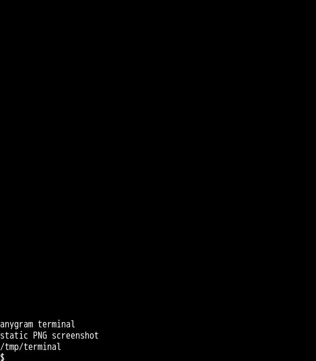

# Terminal keyboard and static PNG execution

This advances R05/R08/R13/R16/R19 within [PR #2](https://github.com/link-foundation/anygram/pull/2).
The hash-verified visual application advertises PNG screenshots but sends only
text edits for regular commands. Both original applications import an unused
keyboard helper and have no control menu. Seven new scenarios fail against the
preceding migration: six lack a keyboard and one lacks the photo upload.

The applicable migration now adds `/controls` to both applications. Its inline
keyboard sends Ctrl+C, Ctrl+D and Ctrl+Z, refreshes the current view and stops
the terminal. The visual refresh captures a screenshot. Callbacks acknowledge
before acting and bind the originating update/session key, user and chat.
Unauthorized, foreign, malformed and retired buttons receive an alert and
cannot control a replacement terminal. Stopping removes the keyboard, cleans
timers/subscriptions and kills the PTY once.

Regular visual commands mark one screenshot pending. The existing output
debounce captures current retained output through actual canvas PNG encoding,
while preserving text edits and interactive GIF commands. Rendering validates
finite preset dimensions before allocation, caps PNG output at 4 MiB and uses
an explicitly named owned InputFile. One session has one active capture; new
requests share that capture. Upload/render failures produce a warning and a
user-visible failure message, without retrying the upload or terminating the
terminal. Stop, replacement and shutdown abort captures. Shutdown drains the
capture tasks after retiring sessions, preserving animation cancellation.

`examples/terminal-controls.js` contains the owned helper functions. The migration
serializes those functions into the complete self-contained patch, so applying
the patch does not require copying another application module. It uses ordinary
Bot API inline-keyboard objects and imports Bot/InputFile from anygram.

## Reproduction and evidence

```sh
node --test tests/terminal-controls.test.js tests/terminal-migration.test.js tests/terminal-shutdown.test.js
node experiments/render-terminal-migration.mjs
npm test --prefix experiments/terminal-runtime
node experiments/terminal-runtime/screenshot-evidence.mjs
npm exec --offline --package=node@20.18.3 -- node --test experiments/vendor-bot-wire.integration.js experiments/terminal-runtime/terminal-wire.integration.js
```

Fifteen portable control cases cover both applications, actual grammY effects,
PNG submissions, upload/canvas/dimension failures and cancellation on stop and
both simultaneous signals. The original-source native scenario makes zero photo
calls. The migrated scenario uploads a 537 by 614 PNG; decoding verifies its
signature, dimensions and foreground pixels. The screenshot below is the actual
uploaded file, rather than a separately recreated image. Its hash and before/after
call counts are in [terminal-static.json](../../screenshots/terminal-static.json).



Four additional Node 20 integrations execute these actual application handlers
over separately selected native, grammY, Telegraf and node-telegram-bot-api HTTP
transports. A bounded independent peer parses keyboard JSON, acknowledgements
and both uploaded photos; actual PNG decoding checks dimensions and filenames.
The dedicated native CI job includes these integrations alongside existing wire
checks. Node 20 retains the known original Telegraf multipart encoder limitation
on newer runtimes; this checkpoint does not resolve that external encoder issue.

Local validation passes all 2,022 core tests on each of Node, Bun and Deno,
27 isolated native checks and six Node 20 vendor/terminal wire cases. Strict
checks scan 154 production sources with zero clones; packaging permits 197
entries. The final coalesced screenshot cancellation scenario also passes in
the focused Deno suite. The generated patch applies cleanly to the pinned sources.

Complete ANSI color/emulator behavior, broader error recovery, native rendering
on other runtimes/platforms, authenticated Telegram delivery and all wider
application/protocol criteria remain unfinished. Local keyboard/photo execution
does not complete the whole downstream migration requirement.
